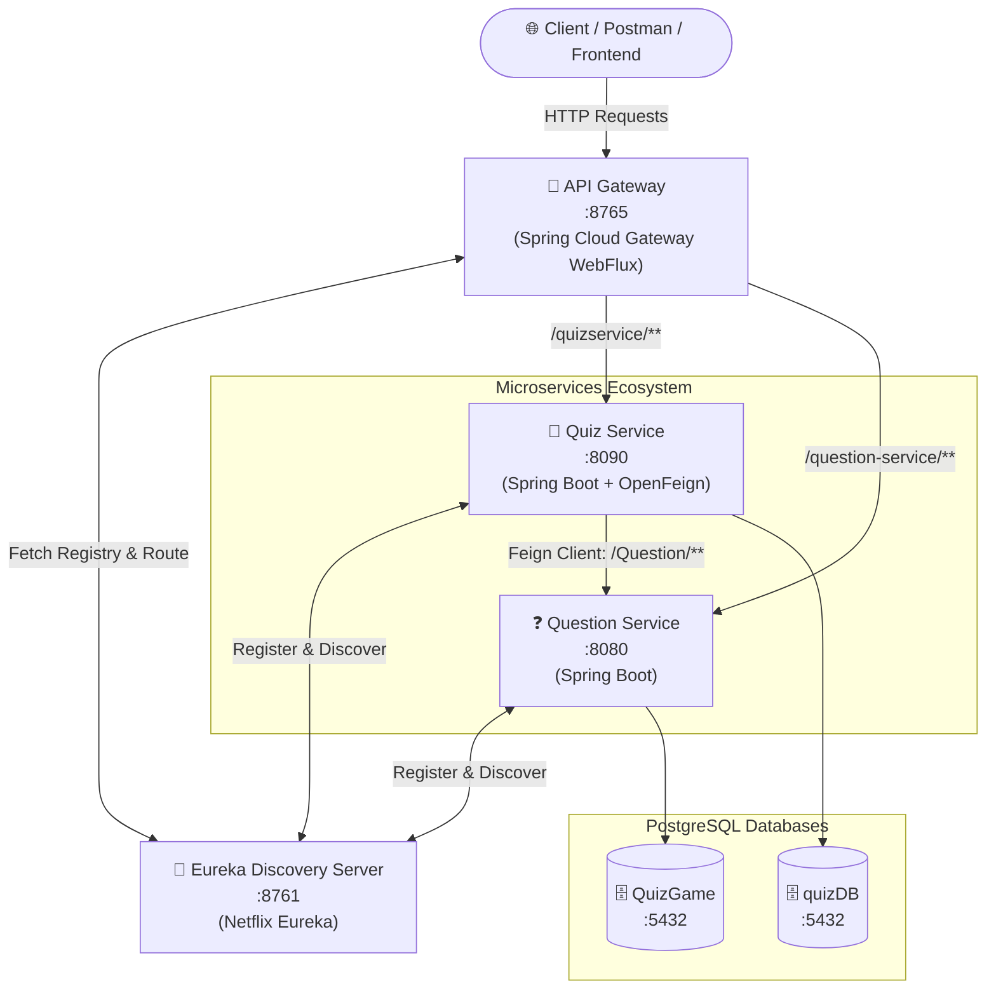

# 🧠 Quiz Application Microservices

A robust, decoupled, and scalable Quiz Application built with **Java 17**, **Spring Boot**, and **Spring Cloud**. The architecture utilizes **Netflix Eureka** for service discovery, **Spring Cloud Gateway (WebFlux)** as an intelligent API Gateway, **OpenFeign** for declarative inter-service REST communication, and **PostgreSQL** for persistent relational storage.

---

## 📐 System Architecture



---

## 🚀 Microservices Overview

| Microservice | Port | Description | Database |
| :--- | :--- | :--- | :--- |
| **`eurekaServer`** | `8761` | Service Registry & Discovery server for registering and locating microservices. | — |
| **`api-gateway`** | `8765` | Reactive WebFlux API Gateway for routing, path rewriting, and load balancing via Eureka. | — |
| **`question-service`** | `8080` | Manages question bank, categories, quiz question generation, and score calculation. | `QuizGame` (PostgreSQL) |
| **`QuizService`** | `8090` | Handles quiz creation, stores quiz question references, and calculates user scores via OpenFeign. | `quizDB` (PostgreSQL) |

---

## 🛠️ Technology Stack

- **Java**: 17
- **Framework**: Spring Boot
- **Cloud Components**:
  - **Spring Cloud Gateway (WebFlux)**: Non-blocking reactive routing & reverse proxy
  - **Spring Cloud Netflix Eureka**: Service Registry & Discovery
  - **Spring Cloud OpenFeign**: Declarative REST client for inter-service calls
  - **Spring Cloud LoadBalancer**: Client-side load balancing
- **Database & Persistence**:
  - **PostgreSQL**: Relational Database Management System
  - **Spring Data JPA / Hibernate**: ORM and data access
- **Utilities**:
  - **Lombok**: Boilerplate reduction (getters, setters, constructors)
  - **Maven**: Build and dependency management

---

## 📋 Prerequisites

Before running the application, make sure you have installed:

- **JDK 17** or higher
- **Maven 3.8+** (or use the included `./mvnw` wrapper)
- **PostgreSQL 14+** running on `localhost:5432`

---

## 🗄️ Database Setup

Create two separate databases in PostgreSQL:

```sql
CREATE DATABASE "QuizGame";
CREATE DATABASE "quizDB";
```

Ensure your PostgreSQL credentials in `question-service` and `QuizService` match your local PostgreSQL configuration:

- **Default User**: `postgres`
- **Default Password**: `Postgres@123`
- *If your credentials differ, update `src/main/resources/application.properties` in both services.*

---

## 🚦 Startup Order

To allow services to register properly, start the applications in the following sequence:

1. **Eureka Server**
   ```bash
   cd eurekaServer
   ./mvnw spring-boot:run
   ```
   *Dashboard available at: `http://localhost:8761`*

2. **Question Service**
   ```bash
   cd question-service
   ./mvnw spring-boot:run
   ```
   *Running on port: `8080`*

3. **Quiz Service**
   ```bash
   cd QuizService
   ./mvnw spring-boot:run
   ```
   *Running on port: `8090`*

4. **API Gateway**
   ```bash
   cd api-gateway
   ./mvnw spring-boot:run
   ```
   *Running on port: `8765`*

> **Note:** Wait 15–30 seconds after startup for Eureka to propagate registered service instances to the API Gateway.

---

## 🔌 API Endpoints (via API Gateway)

All requests can be routed through the API Gateway on port **`8765`**.

### 📝 Quiz Service Endpoints (`/quizservice/quiz/**`)

#### 1. Create a New Quiz
Generates a new quiz by requesting random question IDs from `question-service` and storing the quiz metadata in `quizDB`.

- **Method**: `GET`
- **URL**: `http://localhost:8765/quizservice/quiz/CreateQuiz`
- **Query Parameters**:
  - `no`: Number of questions (e.g., `5`)
  - `category`: Category name (e.g., `Java`)
  - `title`: Title for the quiz (e.g., `JavaBasics`)
- **Example Request**:
  ```http
  GET http://localhost:8765/quizservice/quiz/CreateQuiz?no=3&category=Java&title=JavaBasics
  ```
- **Response**:
  ```text
  Quiz created successfully with ID: 1
  ```

---

#### 2. Get Quiz Questions by ID
Fetches the questions for an existing quiz. Notice that the `rightAnswer` field is omitted (`QuestionWrapper`) so users cannot see answers ahead of time.

- **Method**: `GET`
- **URL**: `http://localhost:8765/quizservice/quiz/getQuiz/{id}`
- **Example Request**:
  ```http
  GET http://localhost:8765/quizservice/quiz/getQuiz/1
  ```
- **Response**:
  ```json
  [
    {
      "id": 1,
      "questionTitle": "Which keyword is used to define a class in Java?",
      "option1": "class",
      "option2": "struct",
      "option3": "define",
      "option4": "object"
    },
    {
      "id": 2,
      "questionTitle": "What is the default value of a boolean in Java?",
      "option1": "true",
      "option2": "false",
      "option3": "null",
      "option4": "0"
    }
  ]
  ```

---

#### 3. Submit Quiz Responses & Calculate Score
Submits chosen options for evaluation. `QuizService` forwards the submission to `question-service` via OpenFeign to verify answers against the database and returns the final score.

- **Method**: `POST`
- **URL**: `http://localhost:8765/quizservice/quiz/submit/{id}`
- **Headers**: `Content-Type: application/json`
- **Request Body**:
  ```json
  [
    {
      "id": 1,
      "response": "class"
    },
    {
      "id": 2,
      "response": "false"
    }
  ]
  ```
- **Response**:
  ```json
  2
  ```

---

### ❓ Question Service Endpoints (`/question-service/Question/**`)

#### 1. Get All Questions
- **Method**: `GET`
- **URL**: `http://localhost:8765/question-service/Question/GetAllQuestions`

#### 2. Generate Question IDs for a Category
- **Method**: `GET`
- **URL**: `http://localhost:8765/question-service/Question/Generate?Category=Java&numQuestions=3`

#### 3. Get Questions Without Answers (Wrappers)
- **Method**: `POST`
- **URL**: `http://localhost:8765/question-service/Question/GetQuestions1,2,3`

#### 4. Evaluate Score Directly
- **Method**: `POST`
- **URL**: `http://localhost:8765/question-service/Question/GetScore`
- **Body**: Array of `{"id": <number>, "response": "<string>"}`

---

## 📁 Repository Structure

```text
QuizMicroService/
├── api-gateway/              # Spring Cloud Gateway (Port: 8765)
│   ├── src/main/java/com/api_gateway/api_gateway/
│   │   └── ApiGatewayApplication.java
│   └── src/main/resources/
│       └── application.properties
├── eurekaServer/             # Netflix Eureka Discovery Server (Port: 8761)
│   ├── src/main/java/com/example/eurekaServer/
│   │   └── EurekaServerApplication.java
│   └── src/main/resources/
│       └── application.properties
├── question-service/         # Question Bank Microservice (Port: 8080)
│   ├── src/main/java/com/example/question_service/
│   │   ├── Controller/QuestionController.java
│   │   ├── Model/ (Question, QuestionWrapper, Response)
│   │   ├── Repo/QuestionRepo.java
│   │   └── Service/QuestionService.java
│   └── src/main/resources/
│       └── application.properties
├── QuizService/              # Quiz Orchestrator Microservice (Port: 8090)
│   ├── src/main/java/com/example/demo/
│   │   ├── Controller/QuizController.java
│   │   ├── Feign/QuizInterface.java
│   │   ├── Model/ (Quiz, Question, QuestionWrapper, Response)
│   │   ├── Repo/QuizRepo.java
│   │   └── Service/QuizService.java
│   └── src/main/resources/
│       └── application.properties
└── README.md
```

---

## 💡 Key Architectural Patterns Used

1. **API Gateway Pattern**: Single entry point for all clients, abstracting internal microservice topology.
2. **Service Discovery Pattern**: Dynamic registration and heartbeat health checks with Netflix Eureka, eliminating hard-coded hostnames and ports.
3. **Declarative REST Client**: Seamless inter-service communication between `QuizService` and `question-service` using Spring Cloud OpenFeign.
4. **Data Separation**: Each microservice manages its own separate database (`Database-per-Service` pattern) ensuring high autonomy and decoupling.
5. **DTO Pattern (Data Transfer Object)**: `QuestionWrapper` decouples internal database entity representations from external consumers, securely hiding sensitive data (correct answers) during active quiz sessions.
